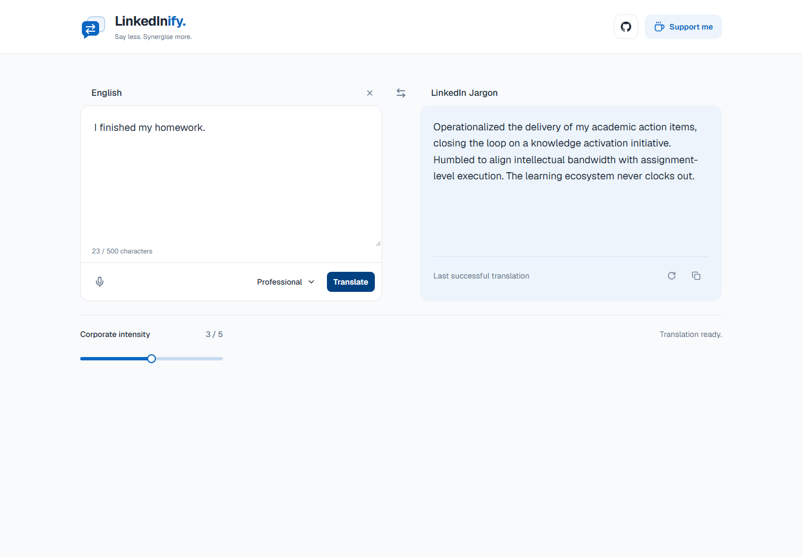
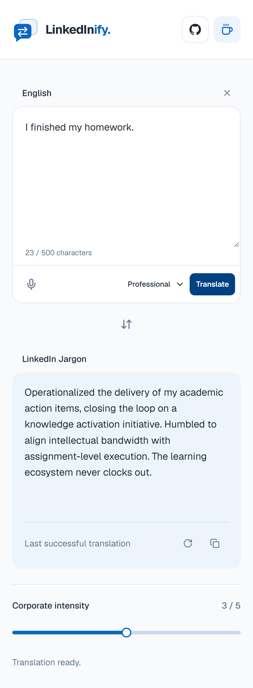

# Corporate Translator

### Say less. Synergise more.

A tiny full-stack translator for turning “I did a thing” into a strategic cross-functional value-delivery initiative. Also translates corporate fog back into English, for when someone has leveraged your last nerve.

Built as a mini project with Next.js, TypeScript, Tailwind CSS, and Groq Cloud. No accounts. No database. No mandatory inspirational story about the CEO's morning coffee.

## The deliverables, as promised in the meeting

- **Two-way translation:** English → LinkedIn Jargon, and back to civilisation.
- **Three personalities:** Professional, Startup Founder, and Recruiter. Same sentence, different networking event.
- **Five intensity levels:** from professional polish to peak thought-leader enthusiasm. Temperatures range from **0.70 to 1.00**.
- **500-character input limit:** because even synergy needs boundaries.
- **Copy, clear, regenerate, retry, and cancel:** a complete stakeholder recovery strategy.
- **Keyboard controls:** Enter translates; Shift+Enter adds a new line. Escape closes the personality picker.
- **Responsive panels:** side by side on desktop, stacked on mobile. The swap control carries your last result into the new input.
- **Honest failure states:** loading disables duplicate submissions; failed requests keep your text and last successful result.

The header links to the [GitHub repository](https://github.com/PeterOu8/Corporate-Translator) and [Buy Me a Coffee](https://buymeacoffee.com/peterou8). The microphone is an inactive placeholder; its roadmap is currently enjoying a well-earned coffee break.

## Screenshots from the synergy department

These are real screenshots of the running app with a **mocked translation fixture**, not a promise that every model response will be identical.



<details>
<summary>Mobile: all the ambition, fewer pixels</summary>



</details>

## Run your own corporate communications department

Use **Node.js 24** and npm.

```bash
npm ci
cp .env.example .env.local
```

Add your server-only key to `.env.local`:

```env
GROQ_API_KEY=your_key_here
```

No `Bearer` prefix. No `NEXT_PUBLIC_` prefix. No posting the key on LinkedIn to celebrate radical transparency. `.env.local` is ignored by Git.

```bash
npm run dev
```

Open [localhost:3000](http://localhost:3000). Restart the dev server after changing environment values. For an existing installation, add `GROQ_API_KEY` to your current `.env.local` rather than overwriting the file. The migration does not edit local secrets. The previous provider key is no longer read; you can remove it yourself once migration is verified.

## How the jargon sausage is made

```text
React Hook Form + Zod
        ↓ POST /api/translate
Bounded JSON reader → shared server validation
        ↓
Groq Cloud → openai/gpt-oss-20b
        ↓ validated final text
Result panel → copy / regenerate / swap
```

The forward prompt turns even a short sentence into an expanded LinkedIn-style post. It uses the supplied phrase guide (networking greetings, performative gratitude, growth clichés, and engagement bait), retains recognisable everyday objects, and avoids invented KPIs or random technical word salad. Intensity 1–2 targets 40–80 words; intensity 3–5 targets 60–110, with a 120-word prompt ceiling. Every forward result is instructed to end with 2–4 relevant hashtags and include 1–2 emojis. Expansion uses rhetorical reflection rather than fabricated achievements; model compliance and factual accuracy still require evaluation. For profanity and hostile criticism, the tone combines cutting corporate sarcasm with absurd professional disengagement while keeping the original anger and complaint. Threats and wishes of harm become boundaries or ending contact, never corporate euphemisms for violence. Reverse mode stays concise and removes hashtags.

Reverse mode ignores personality and intensity and uses temperature **0.70** to ask for concise everyday English.

Requests use **openai/gpt-oss-20b** with `reasoning_effort: low`, `include_reasoning: false`, `max_completion_tokens: 512`, and `stream: false`. The 512-token budget includes reasoning and final text; reasoning is not returned to the client. Forward temperature follows the existing intensity slider (**0.70–1.00**, default **0.85**); reverse mode stays at **0.70**. The upstream timeout defaults to **12 seconds**, configurable with server-only `GROQ_TIMEOUT_MS` (integer 1000–30000); the browser timeout remains **35 seconds**. There are no automatic retries or provider fallbacks. Exhausted completions are rejected as structured errors instead of displaying truncated text; test longer inputs against your own quota before launch. Hosted-model latency varies. Cancel stops the browser waiting; it does not guarantee the provider stops generation or refunds usage.

## Small codebase, impressive job titles

| Location                                         | Actual responsibility                                     |
| ------------------------------------------------ | --------------------------------------------------------- |
| `src/app/page.tsx` / `layout.tsx`                | Page and shared header                                    |
| `src/app/globals.css`                            | Palette, shared layout/button/panel classes               |
| `src/components/translator/Translator.tsx`       | Form state and translation lifecycle                      |
| `InputPanel.tsx` / `OutputPanel.tsx`             | Input, results, and their actions                         |
| `PersonalitySelect.tsx` / `IntensityControl.tsx` | Corporate personality management                          |
| `src/lib/translate-client.ts`                    | Browser request, response validation, timeouts            |
| `src/lib/ai/prompts.ts` / `groq.ts`              | Prompt construction and server-only Groq client           |
| `src/lib/security/request-body.ts`               | 4 KB streamed request-body cap                            |
| `src/app/api/translate/route.ts`                 | Validation, provider call, safe JSON response             |
| `e2e/translator.spec.ts`                         | Desktop/mobile browser journeys with mocked API responses |

## API: the one meeting with a clear agenda

```http
POST /api/translate
Content-Type: application/json
```

```json
{
  "text": "I finished my homework.",
  "mode": "corporate",
  "style": "professional",
  "intensity": 3
}
```

- `mode`: `corporate` or `reverse`.
- `style`: `professional`, `startup founder`, or `recruiter`.
- `intensity`: integer from 1 to 5.
- `text`: trimmed, non-empty, at most 500 characters. Unexpected fields are rejected.

Success: `{ "result": "..." }`. Errors: `{ "error": { "code": "...", "message": "..." } }`. Responses use `Cache-Control: no-store`.

| Status | What happened to the initiative                                                                   |
| ------ | ------------------------------------------------------------------------------------------------- |
| 400    | Malformed JSON or invalid input                                                                   |
| 413    | Body exceeded 4 KB, even without Content-Length                                                   |
| 415    | Content type was not application/json                                                             |
| 502    | Provider failure or empty, invalid, or truncated output                                           |
| 503    | Missing/invalid configuration, invalid upstream credentials, or temporary provider unavailability |
| 429    | Groq rate limit; friendly error without an automatic retry                                        |
| 504    | Provider timeout                                                                                  |

Vercel Firewall may separately reject requests with **429**, including non-JSON responses. The client handles those too. Raw provider errors and credentials are never returned to the browser; submitted text is not logged by the application. Server diagnostics contain only fixed error categories and upstream status codes. Missing keys/configuration produce `SERVER_CONFIGURATION_ERROR`; credential failures produce `PROVIDER_AUTH_ERROR`; quota limits produce `PROVIDER_RATE_LIMITED`; timeouts produce `PROVIDER_TIMEOUT`.

## Quality assurance, without spending AI credits

```bash
npm run format:check
npm run lint
npm run typecheck
npm run test:unit
npm run build
npx playwright install chromium
npm run test:e2e
```

Browser tests start the **production build on port 3100**, so run `npm run build` first. No Groq key is needed for tests: unit tests mock the provider and browser tests intercept the API.

Coverage includes schema rules, prompt settings, provider validation/errors/timeouts, bounded request bodies, successful translation, keyboard submission, personality/intensity values, copy success/failure, regenerate, swap, clear, retry, cancellation, duplicate-request prevention, and desktop/mobile layout. These are automated checks, not a guarantee that the AI will stop saying “ecosystem.”

To refresh the README screenshots in PowerShell after building:

```powershell
$env:UPDATE_SCREENSHOTS = '1'
npx playwright test --grep=README
Remove-Item Env:\UPDATE_SCREENSHOTS
```

Use `npm run format` to format the source. Failed browser runs retain traces in `test-results/`; CI uploads the report for inspection.

## Deployment: take this initiative to production

1. Connect the repository to Vercel and use Node.js 24.
2. Add `GROQ_API_KEY` to the required Vercel deployment environments (Preview/Production as needed) and redeploy. Optionally set `GROQ_TIMEOUT_MS=12000`. Remote environment values are not changed by this migration.
3. Configure **Vercel Firewall** rate limiting for `POST /api/translate`. There is no application-level limiter or Upstash dependency.
4. Require the **CI / checks** GitHub check in branch protection, then run a live forward/reverse translation smoke test.

The workflow in `.github/workflows/ci.yml` runs formatting, lint, type generation/checking, unit tests, production build, and desktop/mobile Chromium tests on pull requests and pushes to `main`. CI needs no production secrets. Firewall rules, branch protection, and deployment credentials must be configured in their respective dashboards; this repo does not provision them.

If a swapped result exceeds the 500-character input limit, validation asks you to shorten it. This is an intentional limit, not a surprise promotion to long-form content strategy.

## Credits and other stakeholder acknowledgements

Powered by [Groq Cloud](https://console.groq.com/docs/model/openai/gpt-oss-20b) using `openai/gpt-oss-20b` via its [Chat Completions API](https://console.groq.com/docs/api-reference). The satire direction was informed by [Polytranslator's LinkedIn Speak guide](https://www.polytranslator.com/linkedin-speak/); the prompt examples in this project are original. Licensed under [LICENSE](LICENSE).

Migration verification uses mocked Groq responses only. No live Groq requests have been made during this migration; latency, output quality, quota access, and whether the initial 512-token budget is sufficient need a separately authorised live smoke test. The shorter prompt retains personalities, factual safeguards, and exaggerated corporate humour while reducing example/history overhead.
